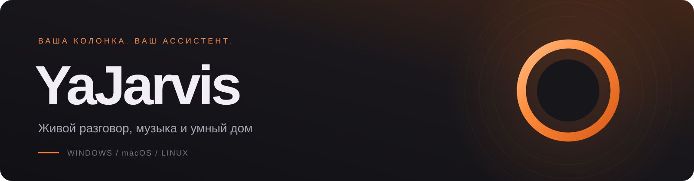
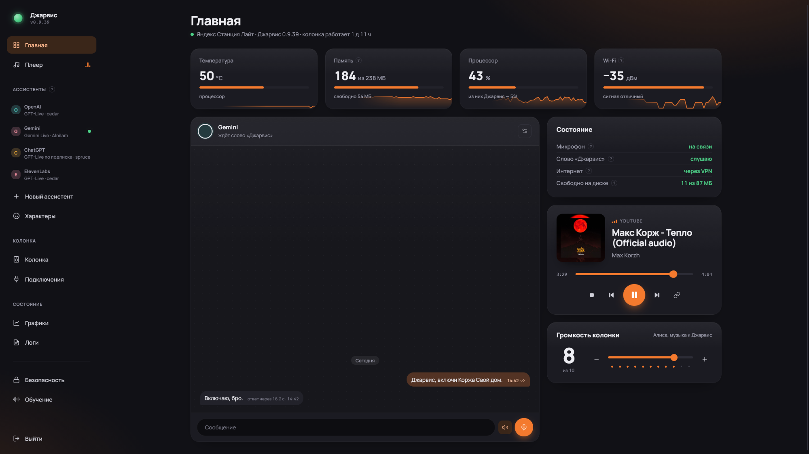
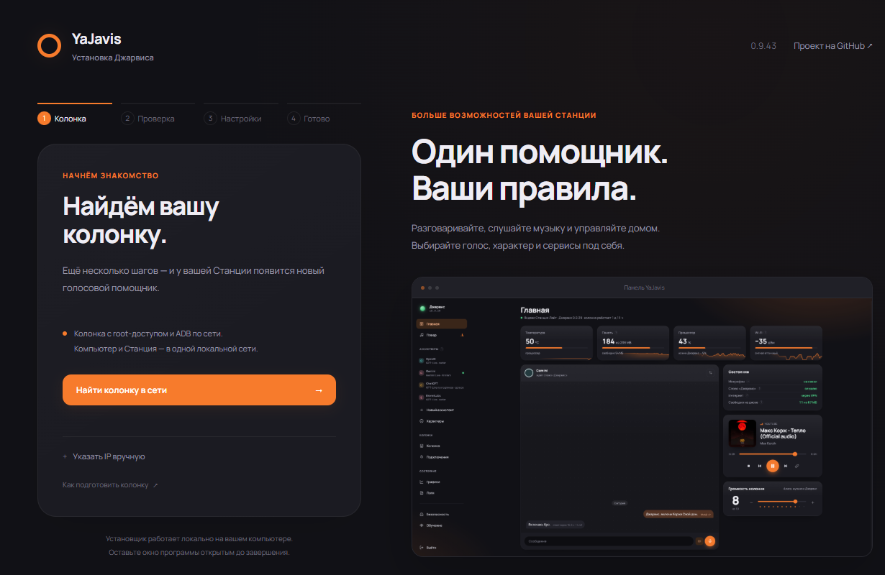
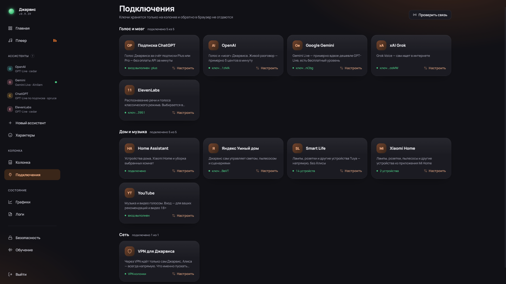
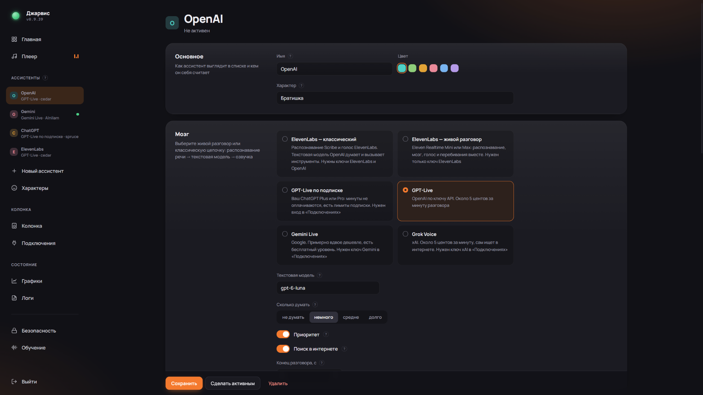
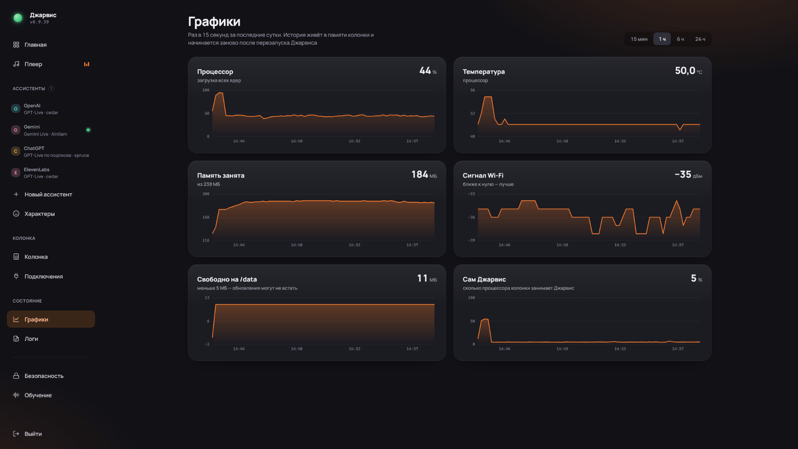

<p align="center">
  
</p>

<h1 align="center">Джарвис на вашей Яндекс Станции</h1>

<p align="center">
  Живой разговор с AI, музыка с YouTube и управление умным домом.<br>
  Локальная активация, несколько голосовых движков и веб-панель — без отдельного сервера.
</p>

<p align="center">
  <a href="https://github.com/newfpv/YaJavis/releases/latest"></a>
  <a href="https://github.com/newfpv/YaJavis/actions/workflows/release.yml"></a>
  <a href="LICENSE"></a>
  <a href="#сколько-колонок-с-джарвисом"></a>
</p>

<p align="center">
  <a href="https://github.com/newfpv/YaJavis/releases/latest"><strong>Скачать</strong></a> ·
  <a href="#установка"><strong>Установить</strong></a> ·
  <a href="#панель-управления"><strong>Посмотреть панель</strong></a> ·
  <a href="https://github.com/newfpv/YaJavis/issues"><strong>Обратная связь</strong></a>
</p>



## Сколько колонок с Джарвисом

<p align="center"></p>

Счёт ведёт сам GitHub: при первом запуске и на каждой новой версии колонка один раз скачивает пустой файл из служебного релиза [`stats`](https://github.com/newfpv/YaJavis/releases/tag/stats). В имени файла только модель и версия — ни идентификаторов, ни данных о владельце. Цифры обновляются раз в 6 часов. Выключается в панели: «Безопасность» → «Счётчик установок».

## Установка

Нужна Яндекс Станция с **root-доступом и ADB по сети**. Подключите компьютер и колонку к одной локальной сети. Получение root-доступа описано в [Yandex Station Extended](https://hackalice.me/).

### Windows

Откройте **PowerShell** и выполните:

```powershell
irm https://github.com/newfpv/YaJavis/releases/latest/download/install.ps1 | iex
```

### macOS и Linux

Откройте **Терминал** и выполните:

```sh
curl -fsSL https://github.com/newfpv/YaJavis/releases/latest/download/install.sh | sh
```

Установщик откроет страницу в браузере. Дальше — три шага:

1. **Выберите колонку.** Она найдётся в сети автоматически; IP можно ввести вручную. Модель и архитектуру установщик определит сам.
2. **Задайте пароль и нажмите «Установить».** Отдельно устанавливать ADB на компьютер не нужно.
3. **Подключите AI-сервис.** В панели добавьте свой ключ или войдите в поддерживаемый аккаунт, затем выберите голос и ассистента.

Панель доступна по адресу **`http://IP-КОЛОНКИ:8080`**. Для погоды и местного времени задайте свой город и часовой пояс во вкладке «Колонка».

<details>
<summary><strong>Как выглядит установщик</strong></summary>

Пока устанавливается Джарвис, справа показываются скриншоты и возможности проекта. Прогресс и журнал доступны рядом.



</details>

<details>
<summary><strong>Скачать установщик вручную</strong></summary>

Можно предварительно просмотреть скрипт или скачать готовый файл из [последнего релиза](https://github.com/newfpv/YaJavis/releases/latest).

| Система | Файл |
| :--- | :--- |
| Windows x64 | `JarvisSetup-windows-amd64.exe` |
| macOS Apple Silicon | `JarvisSetup-darwin-arm64` |
| macOS Intel | `JarvisSetup-darwin-amd64` |
| Linux x64 | `JarvisSetup-linux-amd64` |
| Linux ARM64 | `JarvisSetup-linux-arm64` |

На macOS и Linux дайте скачанному файлу право выполнения: `chmod +x JarvisSetup-*`. Сборки не подписаны сертификатом разработчика. Для удаления или восстановления запустите установщик повторно.

</details>

## Что умеет YaJavis

| Живой разговор | Музыка и дом |
| :--- | :--- |
| **Слово «Джарвис» на колонке.** Активация распознаётся локально. | **YouTube.** Поиск, очередь, похожие треки, пауза и перемотка. |
| **Выбор движка.** OpenAI Realtime, Gemini Live, Grok Voice и ElevenLabs. | **Яндекс Музыка.** Отображение трека Алисы и согласование воспроизведения с YouTube. |
| **Несколько ассистентов.** Свои голос, модель и характер для каждого профиля. | **Умный дом.** Алиса, API Яндекса, Smart Life / Tuya, Xiaomi Home и Home Assistant. |
| **Классический режим.** Распознавание речи, языковая модель и синтез голоса. | **Настройки колонки.** Громкость, подсветка, ночной режим, журнал и графики. |

Доступен экспериментальный вход через аккаунт ChatGPT. Его работа зависит от аккаунта и изменений сервиса. Для облачных API могут требоваться оплата и доступ из вашей сети; при необходимости можно подключить собственный VLESS.

## Панель управления

Spotify голосом и в панели через Soloist — см. [docs/SPOTIFY.md](docs/SPOTIFY.md).

Скриншоты показывают пример настроенной колонки. Новая установка начинается со стандартных значений: **город пустой, часовой пояс UTC, личные аккаунты не подключены**.

<details open>
<summary><strong>Подключения — голосовые сервисы, умный дом и музыка</strong></summary>



</details>

<details>
<summary><strong>Ассистенты — движок, голос, модель и характер</strong></summary>



</details>

<details>
<summary><strong>Графики — процессор, память, температура и Wi-Fi</strong></summary>



</details>

## Колонки и автоопределение

Установщик читает идентификаторы платы и отдельно проверяет процессор, ARM ABI штатной Алисы и компоненты прошивки. Вручную выбирать файл под модель не нужно.

| Семейство | Определяемые модели |
| :--- | :--- |
| **Лайт** | Лайт, Лайт 2 |
| **Мини** | Мини, Мини 2, Мини 3, Мини 3 Про |
| **Миди** | Миди / Cucumber |
| **Другие Станции** | Станция 2, Станция 3, Стрит |
| **Android-модели** | Макс и Станция первого поколения определяются; установка пока не поддерживается |

Полный голосовой тракт **проверен на Лайт первого поколения**. Для остальных моделей статус экспериментальный: работа микрофона и подсветки зависит от прошивки. Установщик остановится с объяснением, если не найдёт необходимых компонентов. Умный хаб не поддерживается.

<details>
<summary><strong>Почему Миди и Станция 2 определяются отдельно</strong></summary>

Внутреннее имя `station-midi` / `yandexmidi` относится к Станции 2. Розничная Миди имеет кодовое имя `Cucumber`. Автоопределение учитывает эту особенность. Соответствия приведены в [каталоге устройств](https://hackalice.me/devices/).

</details>

## Обновления

В панели: **Безопасность → Обновления → Проверить → Обновить**.

Новая версия загружается из [GitHub Releases](https://github.com/newfpv/YaJavis/releases), выбирается под архитектуру колонки и проверяется по **SHA-256**. Проверка обновлений включена по умолчанию; автоматическую ночную установку можно включить отдельно. Перезапуск прерывает музыку и разговор.

Для обновления файлом используйте `jarvisd-arm64` или `jarvisd-armv7`.

## Данные и разработка

Ключи и токены каждого пользователя хранятся на его колонке. Исходные записи, конфигурация автора и полные личные ключи в репозиторий и сборки не входят. Режим записи фона изначально выключен.

Во время разговора используются выбранные облачные сервисы; штатная Алиса сохраняет подключение к Яндексу. Общий Google OAuth-клиент в официальных сборках позволяет подключить Диск по коду. Его упаковка с AES-GCM скрывает строки от случайного просмотра, но не делает распространяемый секрет конфиденциальным.

**[Как хранятся данные](docs/PRIVACY.md)** · **[Сборка и устройство проекта](docs/BUILD.md)** · **[Сторонние компоненты](THIRD_PARTY.md)**

## Поддержать проект

Если YaJavis пригодился, поставьте **Star** вверху страницы. О проблемах расскажите в [Issues](https://github.com/newfpv/YaJavis/issues): укажите модель колонки, версию YaJavis и шаги для повторения, предварительно убрав личные данные из логов.

## Contributors и авторы проектов

Авторы открытых проектов и исследований, на которые опирался YaJavis.

<table>
<tr>
<td align="center" width="110"><a href="https://github.com/dimap"><br><sub><b>dimap</b></sub></a></td>
<td align="center" width="110"><a href="https://github.com/Marker284"><br><sub><b>Marker284</b></sub></a></td>
<td align="center" width="110"><a href="https://github.com/rison1337"><br><sub><b>rison1337</b></sub></a></td>
<td align="center" width="110"><a href="https://github.com/amirilivice"><br><sub><b>amirilivice</b></sub></a></td>
</tr>
<tr>
<td align="center" width="110"><a href="https://github.com/tangenx"><br><sub><b>tangenx</b></sub></a></td>
<td align="center" width="110"><a href="https://github.com/Morvex885"><br><sub><b>Morvex885</b></sub></a></td>
<td align="center" width="110"><a href="https://github.com/nyakokitsu"><br><sub><b>nyakokitsu</b></sub></a></td>
<td align="center" width="110"><a href="https://github.com/dscripka"><br><sub><b>dscripka</b></sub></a></td>
</tr>
</table>

**Дизайн YaJavis вдохновлён [yapanel](https://github.com/dimap/yapanel-web) автора [dimap](https://github.com/dimap).** Тёмная тема, тёплый оранжевый акцент, карточки состояния и подача графиков стали визуальным ориентиром для нашей панели. Спасибо dimap за открытый проект.

Спасибо **[Marker284 и сообществу Yandex Station Extended](https://github.com/Marker284/yandex-station-extended)** за исследования Станций; **[rison1337](https://github.com/rison1337/Alisa-ChatGPT-voice-assistant)** и **[amirilivice](https://github.com/amirilivice/quasard)** — за проекты, послужившие отправной точкой работы с голосовым ассистентом на колонке.

Полный список авторов, использованных подходов и библиотек — в **[CREDITS.md](CREDITS.md)**. Уведомления об авторстве и лицензии сторонних компонентов сохранены в **[THIRD_PARTY.md](THIRD_PARTY.md)** и **[LICENSES](LICENSES)**.

---

[MIT License](LICENSE). Сторонние компоненты сохраняют свои лицензии.

YaJavis — независимый проект сообщества, не официальный продукт производителей колонки и используемых AI-сервисов.
